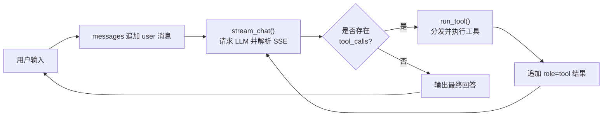

# chatfile.py 本地文件操作 Function Call 智能体

`chatfile.py` 在 `chatyear.py` 的基础上扩展而来，通过 OpenAI 兼容接口与支持 Function Call 的 LLM 对话，并新增一组本地文件操作工具。程序会持续进行「模型请求 → 工具调用 → 结果回填」循环，直到模型不再请求工具为止。

## 功能特性

- 支持流式响应（SSE）与多轮对话上下文。
- 自动解析并拼接流式返回的 `tool_calls`。
- 工具参数使用 JSON 传递，结果统一序列化为 JSON 字符串。
- 内置 12 个工具：2 个通用工具 + 10 个本地文件操作工具。
- 纯文本文件识别：扩展名、MIME 类型、UTF-8 字节探测三重判断。
- 文本读取支持 `utf-8-sig`、`utf-8`、系统默认编码、`gbk`、`latin-1` 逐级尝试。
- 删除目录时提供根目录与当前工作目录保护。

## 文件结构

```text
practice02/
├── chatfile.py                 # 主程序：配置、工具定义、工具实现、流式对话
├── chatyear.py                 # 原始示例程序
├── config.ini                  # LLM 接口配置
├── chatfile_framework.mmd      # Mermaid 代码框架图
└── README.md                   # 本说明文档
```

## 环境依赖

- Python 3.7+
- `requests`

安装依赖：

```bash
pip install requests
```

## 配置

编辑同目录下的 `config.ini`：

```ini
[llm]
base_url = http://localhost:1234/v1
api_key = EMPTY
model = Qwen3VL 4B Instruct
temperature = 0.7
max_tokens = 1024
```

- `base_url`：OpenAI 兼容接口地址，程序会请求 `{base_url}/chat/completions`。
- `api_key`：接口密钥，本地服务通常可填 `EMPTY`。
- `model`：模型名称。
- `temperature` / `max_tokens`：采样温度与最大生成 token 数。

程序按脚本所在目录定位 `config.ini`，因此可以在任意工作目录下启动。

## 运行

```bash
cd D:\fix\free\LLM-Course\Aegent\practice02
python chatfile.py
```

启动后输入问题，例如：

```text
问题: 当前工作目录是什么？
问题: 列出 D:/demo 下的所有文件和子目录
问题: 在 D:/demo 下创建 notes.txt，内容为 hello world
问题: 把 D:/demo/notes.txt 重命名为 todo.txt
```

按 `Ctrl+C` 退出。

## 工具清单

| # | 工具名 | 主要参数 | 说明 |
|---|--------|----------|------|
| 1 | `getDate` | 无 | 调用系统本地 `date` / `time` 命令获取日期时间。 |
| 2 | `isLeapYear` | `year` | 判断指定年份是否为闰年。 |
| 3 | `getCurrentWorkingDirectory` | 无 | 返回当前 Python 进程的工作目录。 |
| 4 | `listDirectory` | `path` | 列出目录下所有文件和子目录，含路径、类型、大小、修改时间。 |
| 5 | `getFileType` | `path` | 返回扩展名、MIME 类型、是否纯文本和大类别。 |
| 6 | `readTextFile` | `path` | 读取纯文本文件完整内容；二进制文件返回错误。 |
| 7 | `createFile` | `directory`, `filename`, `content`, `overwrite` | 在指定目录创建文件，目录不存在时自动创建。 |
| 8 | `editFileContent` | `path`, `mode`, `content`, `old_text`, `new_text` | 支持覆盖、追加、文本替换三种编辑模式。 |
| 9 | `createDirectory` | `directory`, `parents` | 创建目录，默认递归创建父目录。 |
| 10 | `deleteDirectory` | `path` | 递归删除目录及其全部内容，操作不可恢复。 |
| 11 | `deleteFile` | `path` | 删除指定普通文件。 |
| 12 | `renamePath` | `path`, `new_name` | 在同一父目录下重命名文件或目录。 |

工具成功时返回 JSON 对象，失败时返回：

```json
{"error": "错误原因"}
```

## 代码架构

完整框架图见 [`chatfile_framework.mmd`](./chatfile_framework.mmd)，可用支持 Mermaid 的编辑器预览，或渲染为图片：

```bash
mmdc -i chatfile_framework.mmd -o chatfile_framework.svg
```

核心调用流程：



分层说明：

- **入口层**：`__main__` 负责读取输入、维护 `messages`、驱动工具调用循环。
- **配置层**：`load_config()` 读取 `config.ini` 的 `[llm]` 段。
- **对话层**：`stream_chat()` 发起流式请求，解析 `content` 与 `tool_calls`。
- **调度层**：`run_tool()` 解析 JSON 参数、分发到具体实现，并捕获异常。
- **工具实现层**：12 个工具函数，覆盖日期、闰年与本地文件操作。
- **辅助层**：`_resolve()`、`_is_text_file()`、`_read_text()`、`_write_text()` 以及文本扩展名/MIME 常量。
- **系统层**：`os`、`pathlib`、`shutil`、`mimetypes`、`subprocess`。

## 安全说明

- `deleteDirectory` 会**递归删除非空目录且不可恢复**，调用前请确认路径。
- 为避免误删，程序拒绝删除文件系统根目录和当前工作目录。
- `createFile` 默认不覆盖已存在文件，需要覆盖时显式传入 `overwrite=true`。
- `renamePath` 的 `new_name` 只能是名称本身，不允许包含路径分隔符。
- 工具没有目录沙箱限制，可以访问当前用户有权限的任意路径，请谨慎授予模型文件操作能力。
